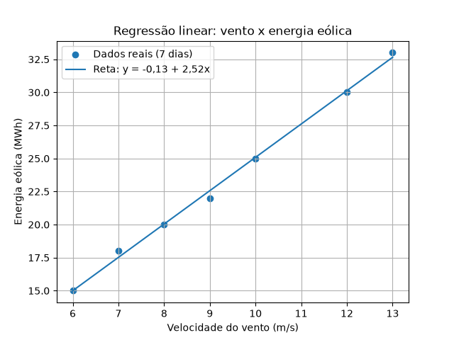

# Sistema da Colônia - Missão Aurora Siger (Fase 3 - FIAP)

Projeto da Atividade Integradora da Fase 3 de Ciência da Computação da FIAP: **"A Aurora Estabelece os Primeiros Sistemas da Colônia"**.

**Aluno:** Gabriel Storer Romero · **RM:** 575479 · **Turma:** 1CCOR

## O que o sistema faz
É um sistema simples em Python que representa a colônia em Marte. Ele:

1. **Organiza os dados** dos sensores (energia, consumo e clima) e os sistemas da colônia de forma hierárquica, com navegação entre eles.
2. **Toma decisões automáticas** com regras de prioridade (o suporte à vida vem primeiro).
3. **Prevê a energia eólica** a partir da velocidade do vento, usando regressão linear (mínimos quadrados).
4. **Analisa o uso de energia**, comparando geração e consumo: avisa quando o consumo passa da geração e sugere armazenar quando a sobra é grande.

Também junta a previsão com a análise: com o vento esperado para amanhã, o sistema avisa antes se vai faltar ou sobrar energia.

## Arquivos
| Arquivo | O que faz |
| ------- | --------- |
| `dados.py` | guarda os dados: sensores, histórico de 7 dias e sistemas |
| `organizacao.py` | navegação: do sistema para o sensor e do sensor para o sistema |
| `decisoes.py` | geração total do dia e as 4 regras de decisão com prioridade |
| `previsao.py` | média, cálculo da reta (regressão linear) e previsão |
| `energia.py` | saldo de energia (geração − consumo) e a sugestão |
| `main.py` | junta tudo e mostra o resultado |
| `grafico.py` | opcional, gera o gráfico da regressão para o relatório (usa matplotlib) |

O sistema (`main.py` e os arquivos que ele usa) não precisa de nenhuma biblioteca de fora, só Python.

## Como rodar
Precisa de Python 3 instalado. Na pasta do projeto:

```
python main.py
```

Para rodar os testes de cada parte separada, é só rodar o arquivo sozinho (ex.: `python decisoes.py`).

Para gerar o gráfico (opcional):

```
pip install matplotlib
python grafico.py
```

## Exemplo de entrada e saída

**Entrada:** o histórico de 7 dias que está no `dados.py`, por exemplo o dia 4:

```
{"dia": 4, "vento": 12, "ge_eolica": 30, "ge_solar": 22, "consumo": 70, "temp_int": 15}
```

e o vento esperado para amanhã (no `main.py` estão fixos 3 valores de teste: 7, 11 e 15 m/s).

**Saída** (`python main.py`):

```
=== SISTEMA DA COLÔNIA - MISSÃO AURORA SIGER ===

--- 1. Sistemas e sensores ---
Sistema Energético -> ['ge_solar', 'ge_eolica']
Sistema Ambiental -> ['temp_int', 'temp_ext', 'vento']
Sistema Operacional -> ['consumo']
O sensor 'vento' pertence ao: Sistema Ambiental

--- 2. Decisões automáticas (7 dias) ---
Dia 1 : ALERTA: falta energia e o vento está fraco, reduzir consumo
Dia 2 : Sistema normal
Dia 3 : Sistema normal
Dia 4 : ALERTA CRÍTICO: frio com falta de energia, desligar módulos não essenciais e manter aquecimento
Dia 5 : Sistema normal
Dia 6 : AVISO: consumo acima da geração, reduzir consumo
Dia 7 : ALERTA: temperatura interna baixa, ativar aquecimento

--- 3. Previsão (regressão linear) ---
Reta: energia = -0.13 + 2.52 x vento
Previsão para vento 11 m/s: 27.61 MWh
Validação: dia 7 previsto 32.31 MWh | real 33 MWh

--- 4. Análise de energia (7 dias) ---
Dia 1 : geração 45 | consumo 52 | ALERTA: consumo maior que geração
Dia 2 : geração 48 | consumo 40 | Energia em equilíbrio
Dia 3 : geração 50 | consumo 50 | Energia em equilíbrio
Dia 4 : geração 52 | consumo 70 | ALERTA: consumo maior que geração
Dia 5 : geração 49 | consumo 30 | SUGESTÃO: armazenar energia excedente
Dia 6 : geração 49 | consumo 55 | ALERTA: consumo maior que geração
Dia 7 : geração 53 | consumo 45 | Energia em equilíbrio

--- 5. Previsão para amanhã ---
Vento 7 m/s: eólica prevista 17.52 | geração prevista 43.66 | consumo médio 48.86 | saldo -5.19 | ALERTA: consumo maior que geração
Vento 11 m/s: eólica prevista 27.61 | geração prevista 53.75 | consumo médio 48.86 | saldo 4.89 | Energia em equilíbrio
Vento 15 m/s: eólica prevista 37.7 | geração prevista 63.84 | consumo médio 48.86 | saldo 14.98 | SUGESTÃO: armazenar energia excedente
```

## Regras de decisão (4 regras, em ordem de prioridade)
1. Temperatura interna ≤ 15 °C **e** geração menor que o consumo → ALERTA CRÍTICO
2. Temperatura interna ≤ 15 °C → ALERTA de temperatura (suporte à vida)
3. Geração menor que o consumo **e** vento < 8 m/s → ALERTA de falta de energia com vento fraco
4. Geração menor que o consumo → AVISO, reduzir consumo

Se nenhuma regra disparar, a saída é "Sistema normal".

## Análise de energia
Saldo = geração total − consumo. Saldo negativo → "ALERTA: consumo maior que geração". Saldo maior que 10 MWh → "SUGESTÃO: armazenar energia excedente". De 0 a 10 → "Energia em equilíbrio". O projeto não modela bateria: o sistema só sugere armazenar.

## Previsão
Regressão linear simples (vento → energia eólica), calculada na mão com o método dos mínimos quadrados:

- Exemplo do enunciado (vento 8, 10, 12 → energia 20, 25, 30): vento 11 → **27,5**
- Com o histórico: **energia = −0,13 + 2,52 × vento**, R² ≈ 0,997
- Validação: com a reta feita só com os dias 1 a 6, o dia 7 foi previsto como 32,31 (real: 33). É um ponto só, então indica, mas não prova, que a reta funciona.



## Limitações
- A potência do vento cresce com o cubo da velocidade, e a turbina tem velocidade de partida, nominal (cerca de 10 a 15 m/s, onde a geração para de crescer) e de corte. A reta não considera nada disso, então só vale na faixa dos dados (6 a 13 m/s).
- O histórico tem só 7 dias e foi montado a partir do exemplo do enunciado, por isso o R² ficou quase perfeito.
- A previsão para amanhã usa a média da solar e do consumo, o que ignora que no histórico a solar cai quando o vento sobe e esconde picos de consumo.
- Temperatura externa, estado dos sensores e bateria ainda não têm dados e ficam como melhoria futura.

## Relatório
O relatório em PDF explica como os dados foram organizados, as regras, o modelo de previsão e a análise de energia.
